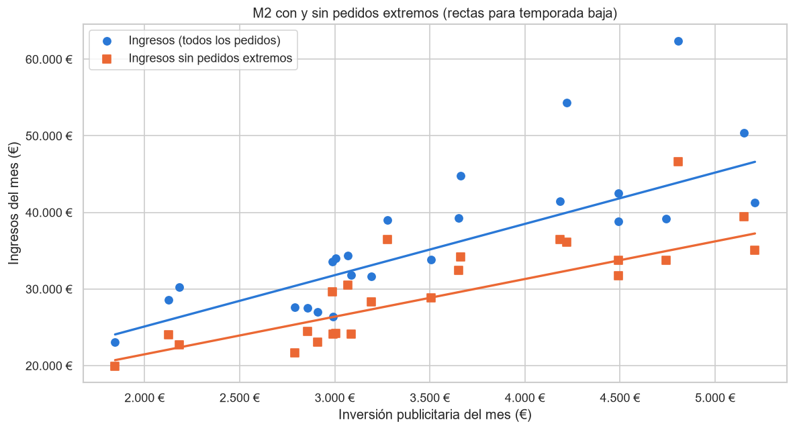

# Tienda Analytics

Sistema de analítica para una tienda online: base de datos relacional,
limpieza de datos, modelos de Machine Learning y cuadro de mando.

> 🚧 Proyecto en desarrollo · Datos simulados con Faker

## Preguntas de negocio

1. ¿Cuánto se vende por cada euro invertido en publicidad? → Regresión lineal
2. ¿Qué tipos de clientes hay? → K-Means (segmentación RFM)
3. ¿Qué pedidos son sospechosos? → Isolation Forest
4. ¿Qué clientes volverán a comprar en los próximos 90 días? → KNN

## Stack

Python · SQLite · pandas · scikit-learn · seaborn · Power BI · Streamlit

## Estructura

| Carpeta | Contenido |
|---|---|
| `sql/` | Esquema de la base de datos |
| `src/` | Scripts de generación, limpieza y features |
| `notebooks/` | Análisis y modelos |
| `models/` | Modelos entrenados |
| `dashboard/` | Informe de Power BI |
| `app/` | Aplicación Streamlit |

## Cómo ejecutarlo

```bash
python -m venv .venv
.venv\Scripts\activate
pip install -r requirements.txt
```

## Cómo generar los datos

```bash
python src/generar_datos.py   # CSV sucios (con anomalías) en data/raw/
python src/limpieza.py        # limpia, carga data/processed/tienda.db y escribe informe_calidad.md
```

## Modelo de datos


## Análisis exploratorio

Notebook: [`notebooks/01_eda.ipynb`](notebooks/01_eda.ipynb) (consultas en SQL con `src/bd.py`).


- **Estacionalidad:** noviembre y diciembre venden un 43,2 % más que la media del resto de meses.
- **Publicidad:** la inversión mensual y los ingresos tienen una correlación de 0,80, también sin contar noviembre ni diciembre.
- **Clientes:** el 10 % de los clientes que más gasta genera el 41,9 % de los ingresos.

## Regresión: publicidad y ventas

Notebook: [`notebooks/02_regresion.ipynb`](notebooks/02_regresion.ipynb) · Modelo: `models/regresion_pedidos.joblib`




**¿Cuánto se vende por cada euro de publicidad?** Cada 100 € más traen **4,2 pedidos completados más al mes** (IC 95 %: 3,4 – 5,3), descontando la temporada de Navidad. En margen, cada euro deja **2,01 € de margen bruto** en la estimación conservadora (sin pedidos extremos). Compensa invertir más, pero solo podemos afirmarlo dentro del rango observado (1.845 – 5.209 € al mes).