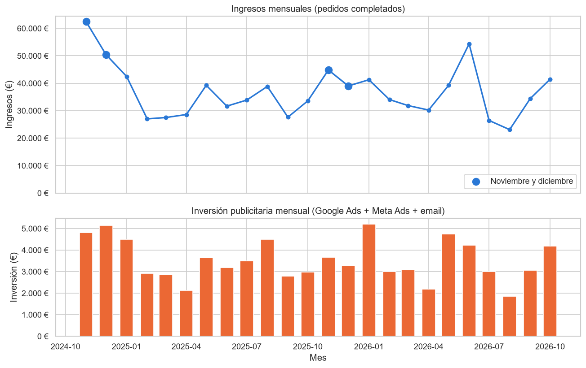

# Tienda Analytics

Sistema de analítica para una tienda online: base de datos relacional,
limpieza de datos, modelos de Machine Learning y cuadro de mando.

> 🚧 Proyecto en desarrollo · Datos simulados con Faker

## Preguntas de negocio

1. ¿Cuánto se vende por cada euro invertido en publicidad? → Regresión lineal
2. ¿Qué tipos de clientes hay? → K-Means (segmentación RFM)
3. ¿Qué pedidos son sospechosos? → Isolation Forest
4. ¿Qué clientes volverán a comprar en los próximos 90 días? → KNN

## Stack

Python · SQLite · pandas · scikit-learn · seaborn · Power BI · Streamlit

## Estructura

| Carpeta | Contenido |
|---|---|
| `sql/` | Esquema de la base de datos |
| `src/` | Scripts de generación, limpieza y features |
| `notebooks/` | Análisis y modelos |
| `models/` | Modelos entrenados |
| `dashboard/` | Informe de Power BI |
| `app/` | Aplicación Streamlit |

## Cómo ejecutarlo

```bash
python -m venv .venv
.venv\Scripts\activate
pip install -r requirements.txt
```

## Cómo generar los datos

```bash
python src/generar_datos.py   # CSV sucios (con anomalías) en data/raw/
python src/limpieza.py        # limpia, carga data/processed/tienda.db y escribe informe_calidad.md
```

## Modelo de datos


## Análisis exploratorio

Notebook: [`notebooks/01_eda.ipynb`](notebooks/01_eda.ipynb) (consultas en SQL con `src/bd.py`).




- **Estacionalidad:** noviembre y diciembre venden un 43,2 % más que la media del resto de meses.
- **Publicidad:** la inversión mensual y los ingresos tienen una correlación de 0,80, también sin contar noviembre ni diciembre.
- **Clientes:** el 10 % de los clientes que más gasta genera el 41,9 % de los ingresos.

## Regresión: publicidad y ventas

Notebook: [`notebooks/02_regresion.ipynb`](notebooks/02_regresion.ipynb) · Modelo: `models/regresion_pedidos.joblib`


**¿Cuánto se vende por cada euro de publicidad?** Descontando la temporada de Navidad, cada 100 € más de publicidad traen:

- **4,2 pedidos completados más al mes** (IC 95 %: 3,4 – 5,3).
- **566,5 € más de ingresos al mes** (IC 95 %: 465 – 714 €), sin contar los pedidos por encima del percentil 99,5 del importe (33 pedidos, el 8,0 % de los ingresos).
- **233 € más de margen bruto**, es decir, **2,33 € de margen por cada euro invertido** (IC 95 %: 1,87 – 3,01 €).

**Por qué 566,5 € y no otra cifra:** la cifra depende de cómo se traten los pedidos enormes, así que se compararon cuatro criterios (sección 6.1 del notebook):

| Criterio | € por cada 100 € | Pedidos excluidos | % ingresos excluidos |
|---|---:|---:|---:|
| Todos los pedidos | 669,7 € | 0 | 0 % |
| Q3 + 3·IQR (referencia) | 491,4 € | 161 | 18,3 % |
| **Percentil 99,5 (elegido)** | **566,5 €** | **33** | **8,0 %** |
| Huber, sin excluir nada | 581,3 € | 0 | 0 % |

Con todos los pedidos, dos pedidos de más de 10.000 € inflan la recta. Q3 + 3·IQR va demasiado lejos: quita también pedidos Premium normales que la publicidad sí trae. El percentil 99,5 y la regresión de Huber, que no excluye ningún pedido, coinciden (566,5 € y 581,3 €). Se elige el percentil 99,5 porque además excluye poco, es el mejor en Leave-One-Out y se aplica igual al margen. Con la referencia más conservadora (Q3 + 3·IQR), el margen sería de 2,01 € por euro.

Compensa invertir más con cualquiera de los criterios, pero solo podemos afirmarlo dentro del rango observado (1.845 – 5.209 € al mes).

El modelo y las imágenes son reproducibles: con los mismos datos, `models/regresion_pedidos.joblib` (que guarda `datos_hasta`, no la fecha de ejecución) y los PNG de `docs/img/` son idénticos byte a byte entre ejecuciones.