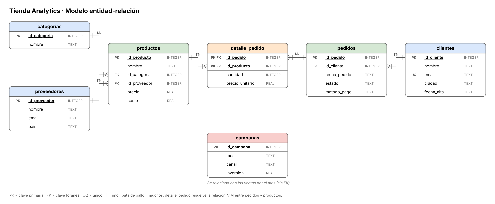
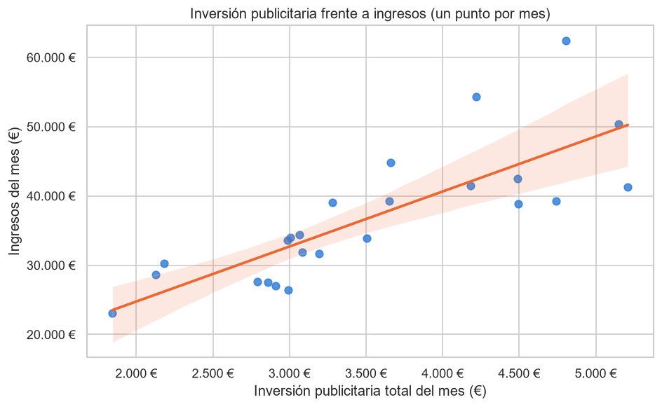
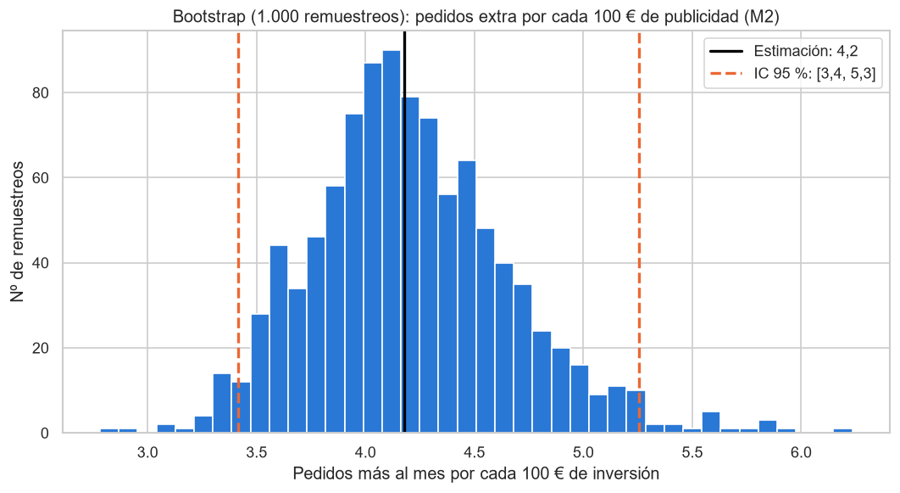
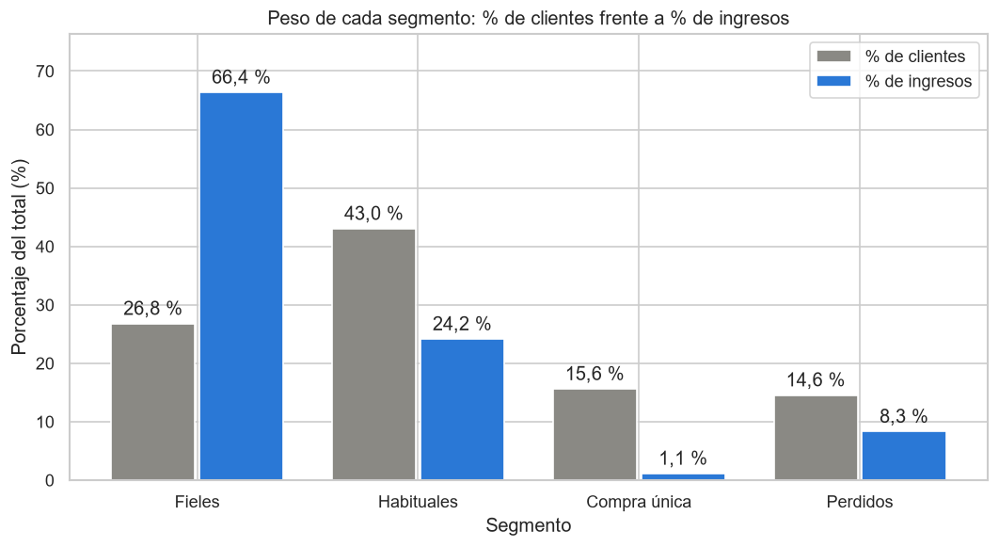
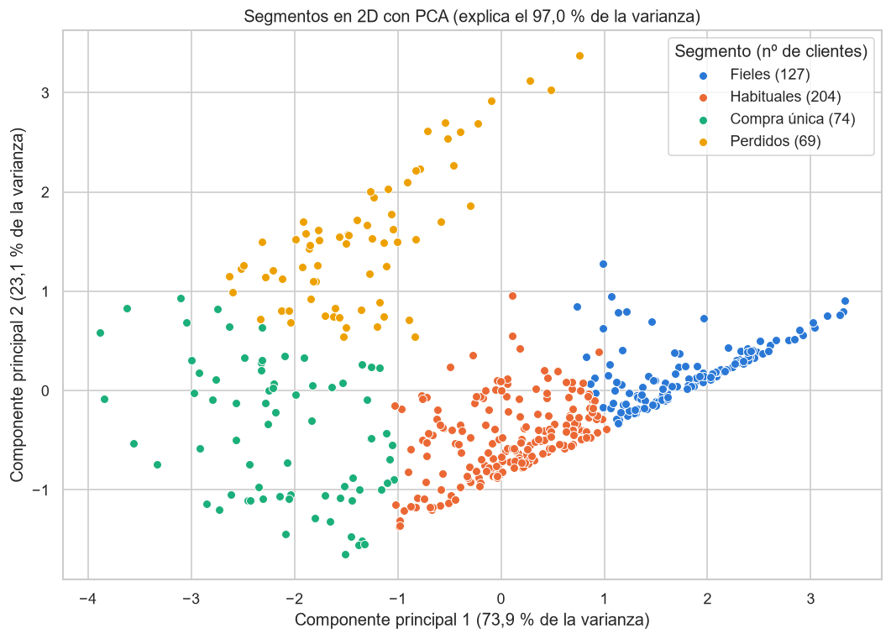
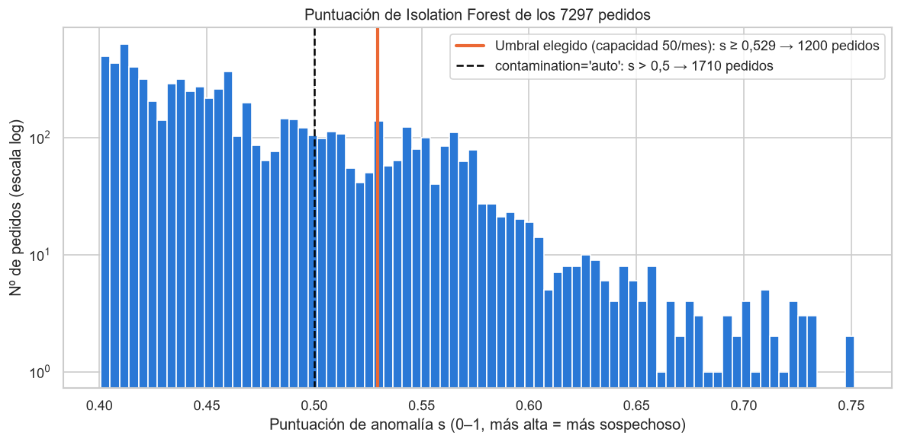
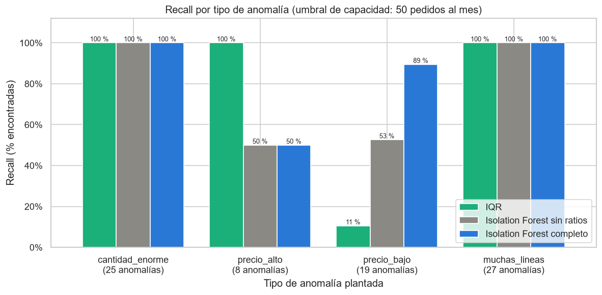

# Tienda Analytics

Sistema de analítica para una tienda online: base de datos relacional,
limpieza de datos, modelos de Machine Learning y cuadro de mando.

> 🚧 Proyecto en desarrollo · Datos simulados con Faker

## Preguntas de negocio

1. ¿Cuánto se vende por cada euro invertido en publicidad? → Regresión lineal
2. ¿Qué tipos de clientes hay? → K-Means (segmentación RFM)
3. ¿Qué pedidos son sospechosos? → Isolation Forest
4. ¿Qué clientes volverán a comprar en los próximos 90 días? → KNN

## Stack

Python · SQLite · pandas · scikit-learn · seaborn · Power BI · Streamlit

## Estructura

| Carpeta | Contenido |
|---|---|
| `sql/` | Esquema de la base de datos |
| `src/` | Scripts de generación, limpieza y features |
| `notebooks/` | Análisis y modelos |
| `models/` | Modelos entrenados |
| `dashboard/` | Informe de Power BI |
| `app/` | Aplicación Streamlit |

## Cómo ejecutarlo

```bash
python -m venv .venv
.venv\Scripts\activate
pip install -r requirements.txt
```

## Cómo generar los datos

```bash
python src/generar_datos.py   # CSV sucios (con anomalías) en data/raw/
python src/limpieza.py        # limpia, carga data/processed/tienda.db y escribe informe_calidad.md
```

## Modelo de datos



## Análisis exploratorio

Notebook: [`notebooks/01_eda.ipynb`](notebooks/01_eda.ipynb) (consultas en SQL con `src/bd.py`).




- **Estacionalidad:** noviembre y diciembre venden un 43,2 % más que la media del resto de meses.
- **Publicidad:** la inversión mensual y los ingresos tienen una correlación de 0,80, también sin contar noviembre ni diciembre.
- **Clientes:** el 10 % de los clientes que más gasta genera el 41,9 % de los ingresos.

## Regresión: publicidad y ventas

Notebook: [`notebooks/02_regresion.ipynb`](notebooks/02_regresion.ipynb) · Modelo: `models/regresion_pedidos.joblib`




**¿Cuánto se vende por cada euro de publicidad?** Descontando la temporada de Navidad, cada 100 € más de publicidad traen:

- **4,2 pedidos completados más al mes** (IC 95 %: 3,4 – 5,3).
- **566,5 € más de ingresos al mes** (IC 95 %: 465 – 714 €), sin contar los pedidos por encima del percentil 99,5 del importe (33 pedidos, el 8,0 % de los ingresos).
- **233 € más de margen bruto**, es decir, **2,33 € de margen por cada euro invertido** (IC 95 %: 1,87 – 3,01 €).

**Por qué 566,5 € y no otra cifra:** la cifra depende de cómo se traten los pedidos enormes, así que se compararon cuatro criterios (sección 6.1 del notebook):

| Criterio | € por cada 100 € | Pedidos excluidos | % ingresos excluidos |
|---|---:|---:|---:|
| Todos los pedidos | 669,7 € | 0 | 0 % |
| Q3 + 3·IQR (referencia) | 491,4 € | 161 | 18,3 % |
| **Percentil 99,5 (elegido)** | **566,5 €** | **33** | **8,0 %** |
| Huber, sin excluir nada | 581,3 € | 0 | 0 % |

Con todos los pedidos, dos pedidos de más de 10.000 € inflan la recta. Q3 + 3·IQR va demasiado lejos: quita también pedidos Premium normales que la publicidad sí trae. El percentil 99,5 y la regresión de Huber, que no excluye ningún pedido, coinciden (566,5 € y 581,3 €). Se elige el percentil 99,5 porque además excluye poco, es el mejor en Leave-One-Out y se aplica igual al margen. Con la referencia más conservadora (Q3 + 3·IQR), el margen sería de 2,01 € por euro.

Compensa invertir más con cualquiera de los criterios, pero solo podemos afirmarlo dentro del rango observado (1.845 – 5.209 € al mes).

El modelo y las imágenes son reproducibles: con los mismos datos, `models/regresion_pedidos.joblib` (que guarda `datos_hasta`, no la fecha de ejecución) y los PNG de `docs/img/` son idénticos byte a byte entre ejecuciones.
## Segmentación de clientes

Notebook: [`notebooks/03_segmentacion.ipynb`](notebooks/03_segmentacion.ipynb) · Modelo: `models/segmentacion_kmeans.joblib` · Explicación: [`docs/explicacion_s7.md`](docs/explicacion_s7.md)

Variables RFM por cliente (`tabla_rfm()` en `src/features.py`): **recencia** (días desde el último pedido completado), **frecuencia** (nº de pedidos completados) y **monetario** (gasto total). Se transforman con `log1p` (frecuencia y monetario) y `StandardScaler`, y se agrupan con K-Means. Se eligió **k = 4** con el codo, la silueta (0,439) y Davies-Bouldin (0,800, el mínimo entre k = 2 y 10).





**¿Qué tipos de clientes hay?** Cuatro:

| Segmento | % clientes | % ingresos | Perfil (medianas) |
|---|---:|---:|---|
| **Fieles** | 26,8 % | 66,4 % | 28 pedidos, último hace 14 días, 3.737,7 € |
| **Habituales** | 43,0 % | 24,2 % | 7 pedidos, último hace 42 días, 878,4 € |
| **Compra única** | 15,6 % | 1,1 % | 1 pedido, hace 292 días, 109,3 € |
| **Perdidos** | 14,6 % | 8,3 % | 4 pedidos, el último hace 580 días, 550,7 € |

Un cuarto de los clientes genera dos tercios de los ingresos. Los segmentos se distinguen por cuántas veces compran y cuándo fue la última vez, no por el gasto por pedido, que es parecido. El jerárquico (ward) coincide a medias con K-Means (ARI 0,481) y DBSCAN solo encuentra un grupo: los clientes forman un continuo, sin grupos densos separados. Con los datos simulados se pudo comparar con el tipo real de cada cliente: coincide en un 79,1 % (ARI 0,405).

### Trabajo futuro

- **Frecuencia relativa en lugar de acumulada.** Usar pedidos al mes desde el alta (frecuencia ÷ antigüedad en meses) en lugar del número total de pedidos. La frecuencia acumulada no distingue "mucho tiempo comprando poco" de "poco tiempo comprando mucho": es la causa del error principal, 50 clientes ocasionales antiguos (0,74 pedidos al mes) clasificados como Fieles (2,19 al mes los fieles de verdad). La idea surgió al analizar los errores con `_verdad_clientes.csv`, así que **no se ha aplicado al modelo actual**: el modelo se eligió solo con métricas internas, y cambiarlo ahora sería elegirlo usando la verdad. Para probarlo bien habría que validarlo sin ella (silueta, Davies-Bouldin, estabilidad) o con datos nuevos.

## Detección de pedidos anómalos

Notebook: [`notebooks/04_anomalias.ipynb`](notebooks/04_anomalias.ipynb) · Modelo: `models/anomalias_iforest.joblib` · Explicación: [`docs/explicacion_s8.md`](docs/explicacion_s8.md)

Variables por pedido (`tabla_pedidos()` en `src/features.py`): importe, nº de líneas, unidades, máximo de unidades en una línea, importe por unidad y el **ratio entre el precio cobrado y el de catálogo** (máximo y mínimo entre sus líneas). Se transforman con logaritmos y se puntúan con `IsolationForest(n_estimators=300)`. El umbral se fija con un **criterio de negocio**: el equipo puede revisar 50 pedidos al mes (el 16,45 % de los pedidos), así que se marcan los 1.200 más sospechosos (s ≥ 0,529). Cada alerta lleva un motivo en palabras (la variable más extrema, en desviaciones robustas), por ejemplo "Muchas unidades: 59 (mediana 2)".





**¿Qué pedidos son sospechosos?** Los que tienen muchas unidades de un mismo producto, muchas líneas o un precio lejos del de catálogo. `data/processed/pedidos_sospechosos.csv` da cada pedido con su puntuación, su posición en el ranking y el motivo, y hay que revisarlos por orden: **de los 50 más sospechosos, 43 son anomalías reales**.

Con los datos simulados se pudo comparar con las 79 anomalías plantadas (1,08 % de los 7.297 pedidos):

| | IQR (una variable cada vez) | Isolation Forest (umbral de capacidad) |
|---|---:|---:|
| Pedidos marcados | 1.298 | 1.200 |
| Anomalías encontradas | 62 de 79 | **73 de 79** |
| Precision | 4,8 % | **6,1 %** |
| Recall | 78,5 % | **92,4 %** |
| F1 | 0,090 | **0,114** |
| PR-AUC (ROC-AUC) | — | **0,762 (0,968)** |
| Precision@50 | — | **86,0 %** |

Isolation Forest encuentra todas las cantidades enormes y todos los pedidos con muchas líneas, el 89,5 % de los precios bajos y solo el 50 % de los precios altos. Sin los ratios de precio, la PR-AUC baja de 0,762 a 0,671: la variable bien construida es lo que más aporta. La precision es baja en los dos métodos porque la capacidad (1.200 revisiones) es mucho mayor que el número de anomalías (79).
